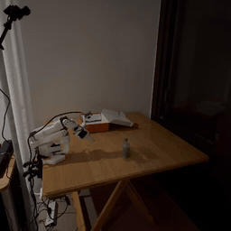
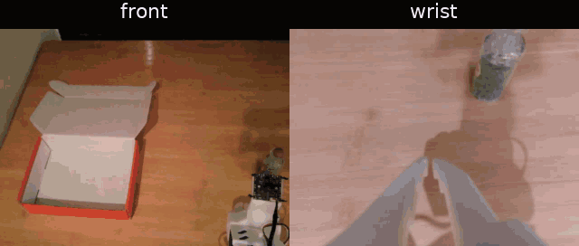
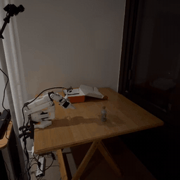
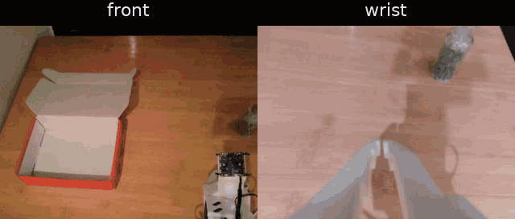
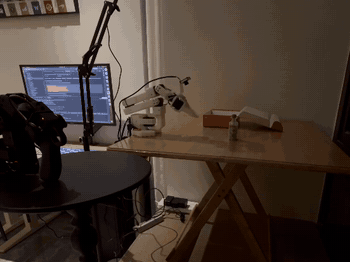
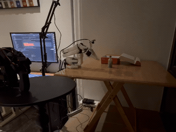

# π₀.₅ Post-Training, RTC & RECAP

Built on [openpi](https://github.com/Physical-Intelligence/openpi), this project reproduces π₀.₅ post-training and deployment in both real-world and simulated environments, implements Guided Real-Time Chunking (RTC) on SO-101, and reproduces the RECAP framework for iterative policy improvement.

The project covers three main components:

- **Post-Training & Deployment**: LoRA fine-tuning, policy inference, and deployment on SO-101 (real robot) and RoboTwin 2.0 (simulation).
- **Guided RTC on SO-101**: Implementation of Guided Real-Time Chunking for responsive real-time inference and smoother action execution on the physical robot SO-101.
- **RECAP（π*₀.₆）**: Reproduction of RECAP, including autonomous rollouts, human-intervention data collection, value model training, and advantage-conditioned policy iteration.

## Demos

**(1) SO-101 Standard Inference**

<table width="100%">
  <tr>
    <td width="30%" align="center" valign="middle"></td>
    <td width="70%" align="center" valign="middle"></td>
  </tr>
</table>

**(2) SO-101 RTC Inference**

<table width="100%">
  <tr>
    <td width="30%" align="center" valign="middle"></td>
    <td width="70%" align="center" valign="middle"></td>
  </tr>
</table>

**(3) RoboTwin 2.0 Inference**

<table width="100%">
  <tr>
    <td width="50%" align="center" valign="middle"></td>
    <td width="50%" align="center" valign="middle"></td>
  </tr>
</table>

**(4) RECAP**

<table width="100%">
  <tr>
    <th width="50%">Rollout</th>
    <th width="50%">HIL</th>
  </tr>
  <tr>
    <td width="50%" align="center" valign="middle"></td>
    <td width="50%" align="center" valign="middle"></td>
  </tr>
</table>

## 1. Environment Setup

Reference hardware: Ubuntu 22.04, RTX 3090 Ti (24 GB), and 32 GB RAM.

| Environment | Python | Purpose |
|---|---|---|
| `.venv` | 3.11 | Policy training, normalization statistics, and serving |
| `so101_hil_lite` | 3.12 | SO-101 calibration, collection, inference, and conversion |
| `openpi-recap-value` | 3.11 | RECAP value training and advantage labeling |
| `RoboTwin` | 3.10 | Simulation and evaluation |

```bash
git clone --recurse-submodules https://github.com/StevenXu945/pi05-so101-post-training.git
cd pi05-so101-post-training
export PROJECT_ROOT="$PWD"

GIT_LFS_SKIP_SMUDGE=1 uv sync
GIT_LFS_SKIP_SMUDGE=1 uv pip install -e .

conda create -n so101_hil_lite python=3.12 -y
conda activate so101_hil_lite
python -m pip install -r so101_hil_lite/requirements.txt
export PYTHONPATH="$PROJECT_ROOT/packages/openpi-client/src${PYTHONPATH:+:$PYTHONPATH}"
```

Place the π₀.₅ base weights in `pi05_base/params` and retain them for LoRA deployment. Run commands from the project root. Set `PROJECT_ROOT` in each new terminal and the above `PYTHONPATH` for SO-101 clients.

## 2. SO-101 Post-Training and Deployment

### Data and Training

Follow the [SO-101 guide](https://wiki.seeedstudio.com/lerobot_so100m_new/) for assembly and calibration, then collect demonstrations with `lerobot-record`. Use the same task instruction throughout collection, training, and inference; examples use `Grab the toy into the box`.

Convert data and train in the openpi environment:

```bash
export HF_LEROBOT_HOME="$PROJECT_ROOT/converted_lerobot"
.venv/bin/python scripts/convert_so101_v3_to_v21.py \
  --source="$PROJECT_ROOT/raw_data/so101_sft" \
  --repo-id=local/so101_train_dataset

.venv/bin/python scripts/compute_norm_stats.py \
  --config-name=pi05_so101_lora_finetune
.venv/bin/python scripts/train.py pi05_so101_lora_finetune \
  --exp-name=so101_run_1 --num-train-steps=30000 --no-wandb-enabled
```

Defaults: front/wrist images, 6-dimensional state/action, 16-step action chunks, and batch size 2.

### Standard Inference and RTC

Terminal 1: start the policy server:

```bash
.venv/bin/python scripts/serve_policy.py policy:checkpoint \
  --policy.config=pi05_so101_lora_finetune \
  --policy.dir=checkpoints/pi05_so101_lora_finetune/so101_run_1/29999 \
  --default-prompt="Grab the toy into the box" --port=8000
```

Terminal 2: run the client in `so101_hil_lite`. Adjust ports, calibration IDs, and camera indices for your hardware:

```bash
python scripts/eval_so101.py \
  --port-arm=/dev/ttyACM0 --robot-id=my_awesome_follower_arm \
  --front-camera=0 --wrist-camera=2 --host=127.0.0.1 --server-port=8000 \
  --prompt="Grab the toy into the box" \
  --duration=40 --fps=30 --chunk-exec=8 --execute
```

- **RTC**: use the same server and replace `--chunk-exec=8` with `--rtc --rtc-inference-delay=6 --rtc-execution-horizon=8 --rtc-max-guidance-weight=10` to overlap inference and execution.
- **Dry run**: omit `--execute` to check observations and inference.
- **Recording**: add `--video-dir=eval_result/run_name`.

## 3. RoboTwin 2.0 Post-Training and Evaluation

Install RoboTwin and simulation assets using the [official guide](https://robotwin-platform.github.io/doc/usage/robotwin-install.html). Training requires LeRobot v2.1 data, downloaded from the official dataset or collected and converted locally.

These examples expect data at `$PROJECT_ROOT/RoboTwin_lerobot_v21_50ep`. For other datasets, update both the configuration’s `repo_id` and `HF_LEROBOT_HOME`. The `50ep` configuration name does not automatically subset data.

```bash
export HF_LEROBOT_HOME="$PROJECT_ROOT"
.venv/bin/python scripts/compute_norm_stats.py \
  --config-name=pi05_robotwin_50ep_lora_finetune
.venv/bin/python scripts/train.py pi05_robotwin_50ep_lora_finetune \
  --exp-name=robotwin_50ep_run1 --num-train-steps=30000 --no-wandb-enabled

.venv/bin/python scripts/serve_policy.py policy:checkpoint \
  --policy.config=pi05_robotwin_50ep_lora_finetune \
  --policy.dir=checkpoints/pi05_robotwin_50ep_lora_finetune/robotwin_50ep_run1/29999 \
  --port=8000
```

In another terminal, evaluate a matching task in the `RoboTwin` environment:

```bash
conda activate RoboTwin
bash robotwin_eval/eval_openpi.sh \
  --robotwin-root="$PROJECT_ROOT/../RoboTwin" \
  --task-name=adjust_bottle --task-config=demo_clean \
  --host=127.0.0.1 --port=8000 --episodes=5 --exec-steps=8
```

Results are saved under `eval_result/robotwin_openpi/`. See the [evaluation guide](robotwin_eval/README.md) for more options.

## 4. SO-101 RECAP Iteration

Iterative training loop (starting from task-specific SFT):

```text
[Task demonstration data]
        |
        v
[Task-specific SFT initialization]
        |
        v
+---- Iteration k = 1..K ------------------------------------+
| 1) Deploy current policy and collect rollouts / HIL data   |
| 2) Merge into cumulative data pool: D <- D U new_data      |
| 3) Train value function on D                               |
| 4) Compute N-step advantages and binary indicator tags     |
| 5) Train advantage-conditioned policy from fixed SFT seed  |
| 6) Deploy with positive condition for the next iteration   |
+------------------------------------------------------------+
        |
        v
[Updated policy for evaluation and further collection]
```

The value model runs offline only. Each round trains the value model and policy from their respective fixed initializations, then uses the updated policy for collection.

### Environment and Initialization

```bash
conda create -n openpi-recap-value python=3.11 -y
conda activate openpi-recap-value
python -m pip install -r value_runtime/requirements.txt -c value_runtime/constraints-tested.txt
hf download ybpy/vlm_ckpt \
  --include 'gemma-3-270m/step_00020000/*' --include 'tokenizer.model' \
  --local-dir .openpi_cache/recap_value
```

### 4.1 Deploy the Initial Policy and Collect Rollouts

Use the SFT server from Section 2 in terminal 1. Collect in `so101_hil_lite` in terminal 2; add `--dry-run` to check connectivity first.

```bash
conda activate so101_hil_lite
python so101_hil_lite/record.py \
  --follower-port=/dev/ttyACM0 --follower-id=my_awesome_follower_arm \
  --leader-port=/dev/ttyACM1 --leader-id=my_awesome_leader_arm \
  --front-camera=0 --wrist-camera=2 --host=127.0.0.1 --port=8000 \
  --policy-id=so101_run_1_29999 --prompt="Grab the toy into the box" \
  --root=so101_hil_lite/data/toy_round1 --repo-id=local/so101_toy_round1 \
  --episodes=20 --duration=40 --fps=30
```

Controls:

1. Press Enter to align, move the leader to position the follower, arrange objects, then press Enter again to start.
2. Press `i` to pause, support the leader, then Enter to take over. After correction, press `i` to check alignment and resume the policy.
3. Press `s` for success, `f` for failure, or `q` to abort. Mark an outcome explicitly after a timeout.

Reset the scene between episodes. Conversion excludes paused frames and aborted trajectories. Retain intervention-free successes and failures for threshold estimation. HIL uses synchronous inference.

### 4.2 Validate, Set Reward Scales, and Split Data

Run in `so101_hil_lite` and adjust validation episode IDs to your data.

```bash
python so101_hil_lite/check_dataset.py so101_hil_lite/data/toy_round1
python so101_hil_lite/convert_to_recap.py \
  so101_hil_lite/data/toy_round1 datasets/toy/prepared/round1 \
  --fps=30 --task-max-steps=1201 --round-id=1 \
  --validation-episodes 16 17 18 19
```

Example rewards: nonterminal −1, successful terminal 0, failed terminal −1201, with normalization scale 2401. Reuse first-round scales from `recap_manifest.json` in later rounds.

### 4.3 Import Demonstrations and Merge the Data Pool

Import demonstrations for the same task and merge them with this round’s rollouts.

```bash
python so101_hil_lite/merge_recap_datasets.py prepare-demonstrations \
  converted_lerobot/local/so101_train_dataset datasets/toy/prepared/demos \
  --task-scales-json=datasets/toy/prepared/round1/meta/recap_manifest.json \
  --policy-id=human_demo --assume-success

python so101_hil_lite/merge_recap_datasets.py merge \
  datasets/toy/prepared/demos datasets/toy/prepared/round1 \
  --output=datasets/toy/pools/round1
```

Use `--assume-success` only for entirely successful demonstrations; otherwise pass `--outcomes-json`. To omit demonstrations, merge only this round’s data. Use new output directories.

### 4.4 Train the Value Model

Stop the GPU policy server and switch to the value-model environment.

```bash
conda activate openpi-recap-value
python value_runtime/train.py \
  --data=datasets/toy/pools/round1 \
  --checkpoint=.openpi_cache/recap_value/gemma-3-270m/step_00020000 \
  --tokenizer=.openpi_cache/recap_value/tokenizer.model \
  --output=checkpoints/recap_value/toy_round1 \
  --freeze-mode=all_backbones --batch-size=1 --steps=5000 \
  --val-interval=1000 --save-interval=1000
```

The model uses SigLIP + Gemma3-270M. `all_backbones` freezes the backbones and trains only fusion layers and the value head.

### 4.5 Compute N-Step Advantages and Labels

Run in the value-model environment and write to a new directory.

```bash
python value_runtime/label_advantage.py \
  --data=datasets/toy/pools/round1 \
  --checkpoint=checkpoints/recap_value/toy_round1/step_00005000 \
  --tokenizer=.openpi_cache/recap_value/tokenizer.model \
  --output=datasets/toy/labeled/round1 \
  --threshold-round=1 --lookahead=50 --positive-ratio=0.4 --batch-size=2
```

At 30 Hz, `N=50` spans about 1.67 seconds. Estimate thresholds using only complete, intervention-free training rollouts from this round. Human frames remain positive; validation frames remain none.

### 4.6 Advantage-Conditioned LoRA Training

In the openpi environment, register labeled data under a separate directory, recompute statistics, and train.

```bash
export HF_LEROBOT_HOME="$PROJECT_ROOT/datasets/toy/policy_round1"
mkdir -p "$HF_LEROBOT_HOME/local"
ln -s "$PROJECT_ROOT/datasets/toy/labeled/round1" \
  "$HF_LEROBOT_HOME/local/so101_stack_recap_labeled_v21"

.venv/bin/python scripts/compute_norm_stats.py \
  --config-name=pi05_so101_recap_lora_relabeled

.venv/bin/python scripts/train.py pi05_so101_recap_lora_relabeled \
  --data.default-prompt="Grab the toy into the box" \
  --exp-name=toy_recap_round1 --num-train-steps=10000 --no-wandb-enabled
```

Keep the dataset identifier `so101_stack_recap_labeled_v21`. Each round starts from the fixed SFT seed `so101_run_1/29999`, without the previous adapter or `--resume`. If changing the seed, update both training and inference configurations.

### 4.7 Deploy the Updated Policy

Terminal 1: serve the updated policy. Terminal 2: collect in `so101_hil_lite` with the positive condition.

```bash
.venv/bin/python scripts/serve_policy.py policy:checkpoint \
  --policy.config=pi05_so101_recap_lora_infer \
  --policy.dir=checkpoints/pi05_so101_recap_lora_relabeled/toy_recap_round1/9999 \
  --default-prompt="Grab the toy into the box" --port=8000
```

```bash
conda activate so101_hil_lite
python so101_hil_lite/record.py \
  --follower-port=/dev/ttyACM0 --follower-id=my_awesome_follower_arm \
  --leader-port=/dev/ttyACM1 --leader-id=my_awesome_leader_arm \
  --front-camera=0 --wrist-camera=2 --host=127.0.0.1 --port=8000 \
  --policy-id=toy_recap_round1_9999 --prompt="Grab the toy into the box" \
  --advantage=positive \
  --root=so101_hil_lite/data/toy_round2 --repo-id=local/so101_toy_round2 \
  --episodes=20 --duration=40 --fps=30
```

Evaluate autonomously without intervention; corrections are allowed during training collection. Deploy RECAP with `record.py --advantage=positive`; the standard/RTC client has no advantage-condition argument.

### 4.8 Continue to the Next Round

Convert new data in `so101_hil_lite`, reusing first-round scales and retaining the historical pool.

```bash
python so101_hil_lite/convert_to_recap.py \
  so101_hil_lite/data/toy_round2 datasets/toy/prepared/round2 \
  --task-scales-json=datasets/toy/prepared/round1/meta/recap_manifest.json \
  --round-id=2 --validation-episodes 16 17 18 19

python so101_hil_lite/merge_recap_datasets.py merge \
  datasets/toy/pools/round1 datasets/toy/prepared/round2 \
  --output=datasets/toy/pools/round2
```

Repeat 4.4–4.7 with round2 paths and experiment names, set `--threshold-round=2`, and recompute normalization statistics. Both models reuse their respective fixed initializations. The historical pool already contains old data; avoid merging it twice.
